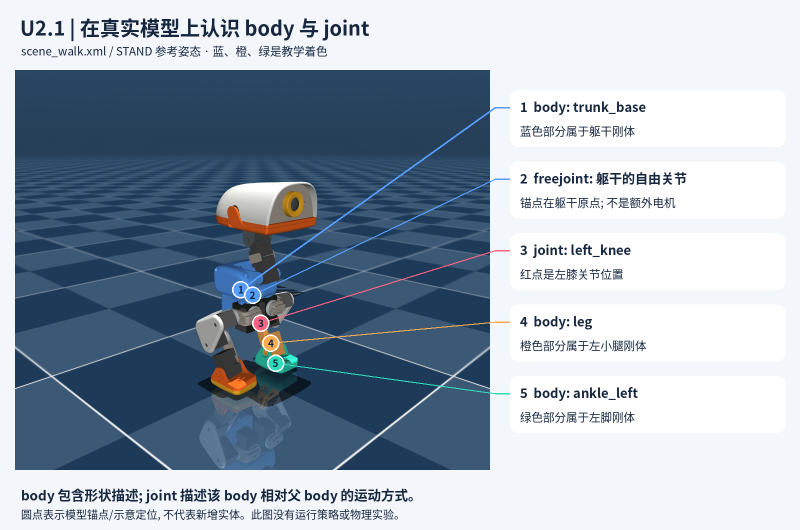
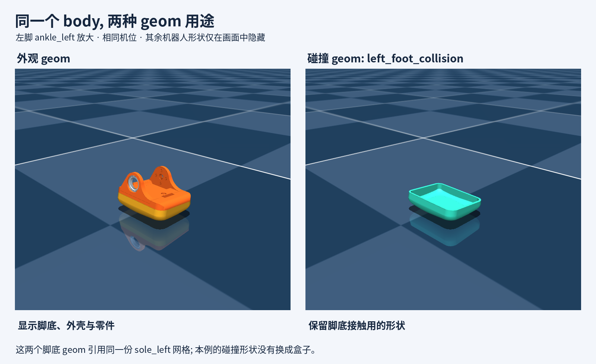
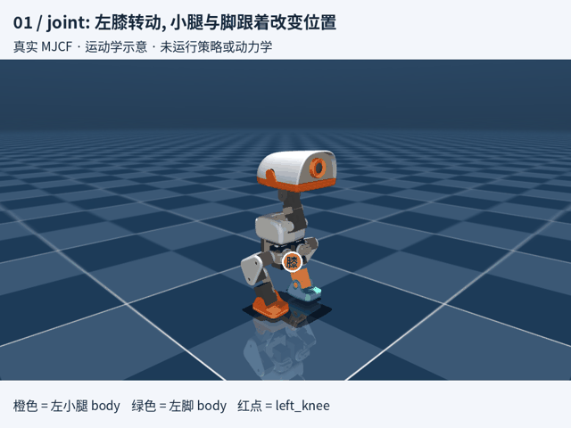
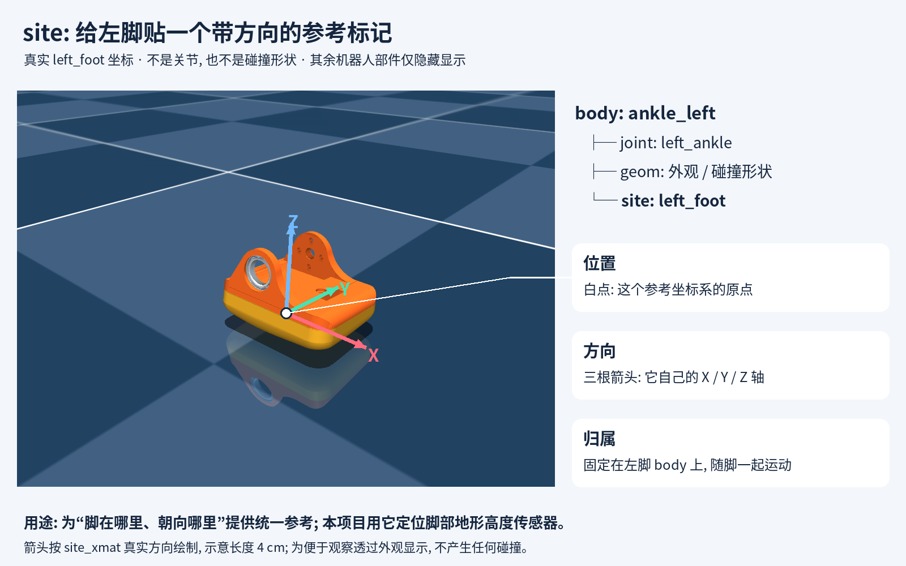
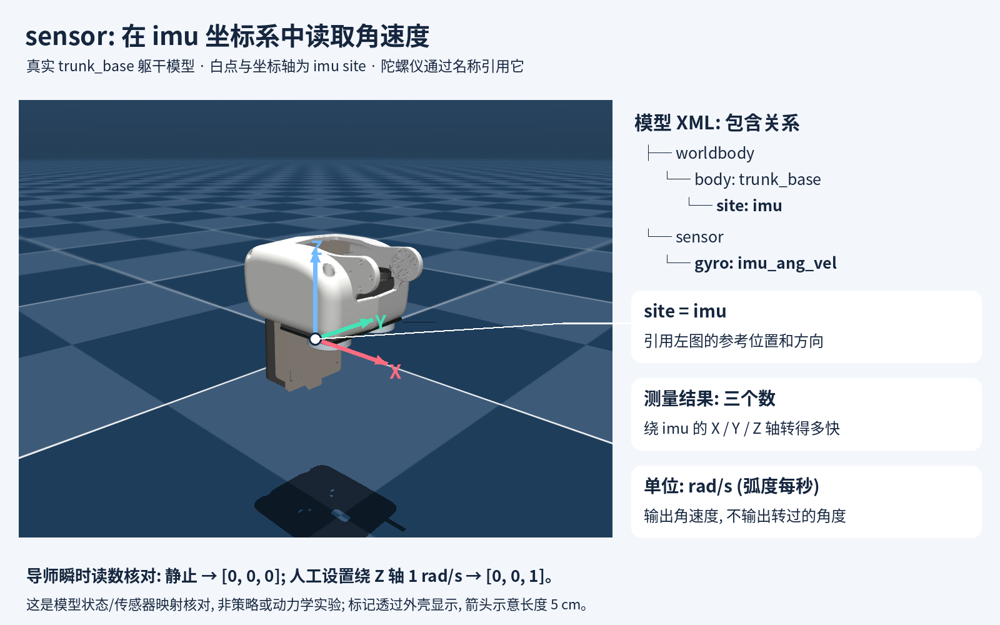
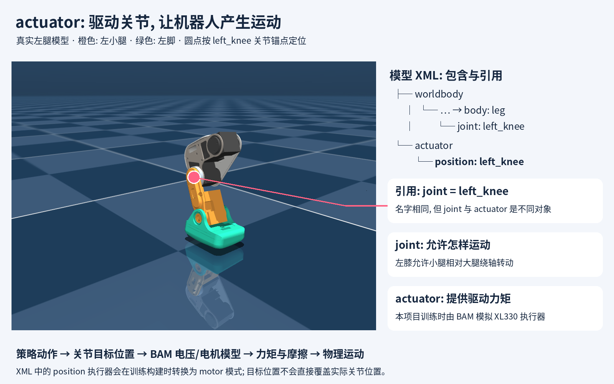
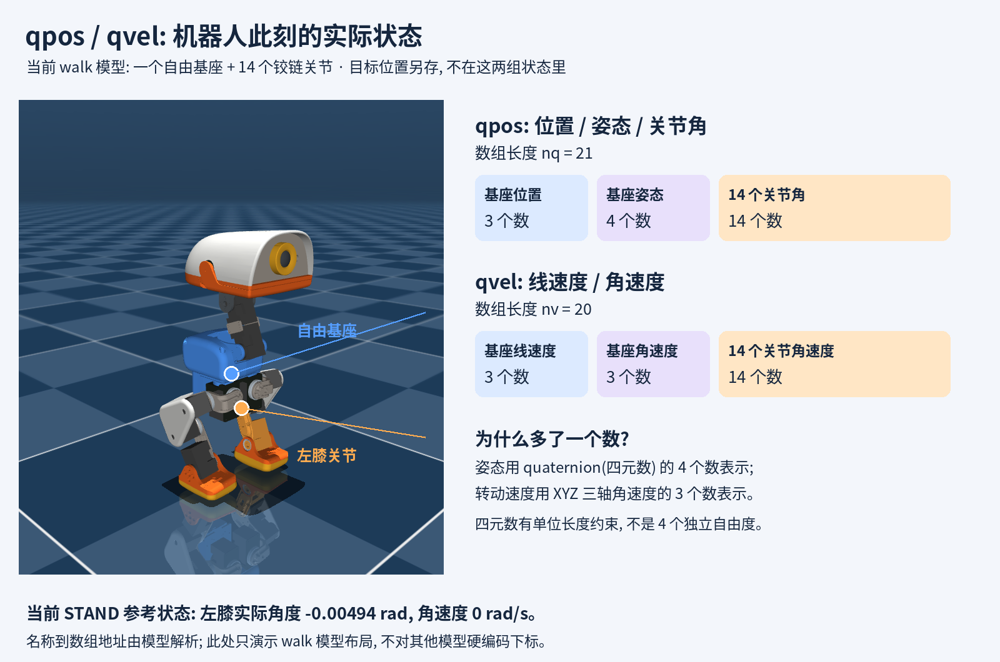

# U2.1 图解: 机器人模型、传感器、执行器与状态

这组图直接由项目 `scene_walk.xml` (包含 `robot_walk.xml`) 渲染, 使用场景中的 STAND 参考姿态. 蓝、橙、绿为教学着色, 名称与标注位置来自实际模型. 图文替代抽象代码示例, 树结构保留用于解释包含关系.

## 2026-09-08 收课速览

今天 U2.1 从头重讲, 词汇范围已覆盖, 当前已暂停. 后续不从头重启, 也不把“已讲完”当作全部验收通过.

| 概念 | 一句话回顾 | 对照图 |
|---|---|---|
| body(刚体) | 作为整体运动的部分, 可包含多个固定装配的零件形状 | [整机标注](01-body-joint.png) |
| joint(关节) | 定义所属 body 相对直接父 body 允许怎样运动 | [整机标注](01-body-joint.png) |
| freejoint(自由关节) | 让躯干相对世界拥有 3 个平移和 3 个转动自由度 | [12 秒演示](03-model-tour.mp4) |
| geom(几何体) | 描述外观和/或碰撞形状, 按任务选择需要的碰撞范围 | [左脚对照](02-geom-comparison.png) |
| site(参考坐标系) | 固定在 body 上的具名位置和方向, 可类比 ROS frame | [左脚三轴](04-site-left-foot.png) |
| sensor(传感器) | 定义测量功能; gyro 引用 imu site 输出三轴角速度 | [IMU 标注](05-sensor-imu.png) |
| actuator(执行器) | 驱动关节, 项目训练由 BAM 模拟 XL330 行为 | [左膝驱动](06-actuator-left-knee.png) |
| qpos / qvel | 保存实际位置状态与速度; 当前 walk 模型分别 21/20 维 | [状态布局](07-qpos-qvel.png) |

今天澄清了三个容易混淆的地方: body 的直接父子关系与间接运动链不同; 外观、碰撞和重量不是同一项配置; 关节目标位置不等于实际状态. 自由基座姿态用单位四元数的 4 个数表示, 角速度用 3 个数, 因而 nq/nv 不同.

学习证据: 用户主动指出间接 joint 情况, 自主表达 XML 对象包含关系, 并用 ROS/TF 正确类比 site. sensor/actuator 为用户自述明白; qpos 小判断尚未回答. 导师制作 6 张标注图、12 秒 MP4 与动图, 完成模型/传感器静态与瞬时核对; 没有用户动手实验或新增训练.

下次起点: 可先用一句话确认 qpos 的目标/实际区别 (待答题保留在第 7 节, 今天不作答), 然后 U2.2 从 HOME_FRAME 与关节名字映射开始. 四元数推导未展开, 不默认加课. 正式进度以 [progress.md](../../progress.md) 为准.

## 1. 先在机器人上找到刚体和关节



- 蓝色是 `trunk_base`: 躯干 body(刚体). 蓝色的各块形状跟着同一个躯干整体运动.
- 橙色是 `leg`: 左小腿 body. 红点 `left_knee` 位于它与上一级大腿之间, 描述小腿相对大腿的转动.
- 绿色是 `ankle_left`: 左脚 body. 它通过自己的 `left_ankle` 关节相对小腿转动.
- `trunk_base_freejoint` 是躯干拥有的自由关节描述项. 图中标的是躯干原点, 并非一颗真实舵机; 它允许躯干相对世界平移、转动.

```text
worldbody: 世界
└── body: trunk_base, 躯干
    ├── freejoint: trunk_base_freejoint
    └── body: yaw2roll
        └── body: hip_l
            └── body: upper_leg_left, 左大腿
                └── body: leg, 左小腿
                    ├── joint: left_knee
                    └── body: ankle_left, 左脚
                        ├── joint: left_ankle
                        ├── geom: 脚底外观
                        ├── geom: left_foot_collision
                        └── 其他描述项
```

树中只保留本节需要的节点, 省略其他关节、分支和描述项; “脚底外观”是教学标签, 不是该 geom 的实际名字. joint 写在自己所属的 body 内, 定义该 body 相对直接父 body 的运动方式.

## 2. 放大左脚: 外观与碰撞分开看



左边显示 `ankle_left` 的外观 geom(几何体): 脚底、外壳等. 右边只显示 `left_foot_collision`: 这才是本模型用于脚底接触的形状. 两边机位与刚体姿态相同, 其余机器人形状仅在画面中隐藏.

两个脚底 geom 都引用 `sole_left` 网格, 所以本例没有把碰撞形状简化成盒子. 同一个 body 可以拥有多个 geom; 外观和碰撞是配置上的分工, 碰撞 geom 也能显示出来. 不能仅凭画面里看见一个零件, 就断定它参与碰撞.

### 图上“只剩底部”应该怎样理解

针对这张左脚图, 可以说碰撞 geom 选用了脚底零件的形状. 不是从整个脚的外观 geom 上自动裁下一块: 整只脚的外观由多个 geom 组成, 其中脚底外观 geom 与 left_foot_collision 是两条独立声明, 都引用 sole_left 网格, 位置和朝向也相同. 这说的是形状资源的复用, 不把渲染网格细节等同于碰撞算法的所有接触细节.

范围限于当前 walk 模型的左脚示例, 不是整个项目“只有底部能碰撞”的规则. robot_walk.xml 还包含右脚底以及躯干 power_support、左右小腿 leg 的 self_collision_only 几何配置; 其他任务可以选择其他模型.

### 为什么行走模型优先保留脚底碰撞

源码能确认: config_mjcf_walk.json 显式筛选 sole_left/sole_right 等少量碰撞零件, 不是引擎只能碰脚底. groundcontact 导出配置另外选入头壳、下颌、髋部、电池和躯干外壳等; microduck_constants.py 注释明确它用于覆盖落地接触任务. 源码没有写出“脚部省略所有外壳”的完整历史动机, 下述是结合任务的工程解释, 不是作者原话或性能实测.

正常平地行走中, 脚底首先接触地面, 决定支撑区域和摩擦作用; 同一刚体上方、没有接触环境的外壳碰撞形状通常不会增加这段步态的关键信息. 只选必要碰撞形状可避免额外碰撞检测和接触求解负担, 但未实测该项目具体提速. 这不代表被省略外壳的质量也消失: ankle_left 已有显式 inertial 描述, 碰撞范围与该刚体质量/惯性分开设置.

整个脚部参与碰撞当然可以. 若任务涉及脚侧撞障碍、翻脚支撑、脚背触地, 就要把相关形状补入, 并验证接触. 缺失碰撞部分可能穿过环境, 因而“正常走路够用”不是所有动作都足够准确的保证. 项目按任务选择 walk/groundcontact 等模型, 体现这种接触范围取舍.

参考: [MuJoCo 碰撞检测与接触计算](https://mujoco.readthedocs.io/en/latest/computation/). 官方文档确认碰撞检测和接触力属于仿真计算, 本项目的速度收益仍需对照测量.

## 3. 看它动起来



[观看清晰版 MP4](03-model-tour.mp4)

- 0–4 秒: 手动改变左膝角度, 红点标出关节, 观察橙色小腿与绿色脚部随之改变位置.
- 4–8 秒: 同一只脚切换外观/碰撞形状显示, 看它们各自覆盖的部分.
- 8–12 秒: 保持关节角不变, 手动改变自由基座的位置, 观察整棵机器人子树一起移动.

这是 **运动学示意**, 通过设置 qpos 后调用 `mj_forward` 更新几何关系. 没有调用 `mj_step`, 没有运行策略、BAM 动力学或接触支撑实验. 动画里手动移动躯干不是机器人学会走路; 摆出的关节姿态也不保证稳定或无穿插. 本演示用于看清“谁跟着谁动”, 不用于评价训练效果.

## 4. site: 给左脚贴一个带方向的参考标记



把 site(参考坐标系) 想成粘在脚上的虚拟标记. 它同时定义一个位置和一组方向: 白点是原点, 红 X/绿 Y/蓝 Z 是它的局部坐标轴. 这些轴固定在脚上, 脚转动时跟着转, 不必始终与世界坐标轴对齐. 图中轴按模型真实 site_xmat 绘制, 箭头长度 4 cm 只为看清, 透过外观显示不代表实体穿插.

```text
body: ankle_left
├── joint: left_ankle, 定义脚相对小腿怎样动
├── geom: 描述外观与碰撞形状
└── site: left_foot, 定义关心的位置和方向
```

为什么需要: “脚的位置”可能指脚踝轴、脚底中点或脚尖, 名字为 left_foot 的 site 给代码一个明确一致的参考. 它的位置由模型作者选择, 不会自动寻找接触点或质心. site 不参与碰撞, 不贡献质量和惯性, 自身也不是传感器. 能显示为点/坐标轴, 不等于增加一个零件. [MuJoCo 官方说明](https://mujoco.readthedocs.io/en/stable/XMLreference.html#body-site).

当前项目中, velocity 配置的 foot_height_scan 将 left_foot/right_foot 两个 site 作为地形高度传感器的参考 frame. 本节仅说明“传感器用哪个参考位置”, 不展开射线与数据输出. XML 的位置/朝向定义在所属 body 的局部坐标系; 运动后的世界位置和朝向由仿真计算.

导师核对: left_foot 所属 body 确为 ankle_left; scene_walk.xml 的 STAND 参考姿态下 site 世界位置约为 (0.0000162, 0.0418242, 0.0028722) m, 不把此值当训练实测脚底高度或接触判据. 图由生成器 [render_u21_site.py](../../tools/render_u21_site.py) 读取 site_xpos/site_xmat 投影, 检查旋转矩阵正交性并目视检查图例. 复现命令: `MUJOCO_GL=egl .venv/bin/python docs/learning/tools/render_u21_site.py`. 未运行策略或动力学实验.

## 5. sensor: 在指定坐标系中测量什么



承接用户的 ROS/TF 类比: site 对应一个具名参考 frame, sensor(传感器) 定义测量功能和输出. 以 gyro(陀螺仪) imu_ang_vel 为例: 它通过 site="imu" 引用躯干上的 imu site, 输出沿该 site 局部 XYZ 三轴表达的角速度, 单位 rad/s. 名字 imu 指参考坐标系, 不是说光写了这个 site 就有了全部 IMU 数据.

```text
模型 XML
├── worldbody
│   └── body: trunk_base
│       └── site: imu
└── sensor
    └── gyro: imu_ang_vel
        └── 引用: site = imu
```

最后一行是属性说明, 不是额外 XML 元素. sensor 配置位于模型的 sensor 区域, 并非嵌套在 site 内; 通过名字建立引用关系. 就像 ROS 中 frame_id 指定数据使用的参考坐标系, angular_velocity 则是测量数据, 此处不涉及 ROS 消息发布.

导师用 CPU MuJoCo 3.10.0 做瞬时映射核对: STAND 姿态、速度为零时 imu_ang_vel 是 [0,0,0]; 人工将自由基座 Z 角速度设为 1 rad/s, mj_forward 后读数为 [0,0,1]. 该姿态下 imu 轴与世界轴对齐. 输出 1 表示每秒转 1 弧度, 不是“已经转了 1 弧度”. 测试没有运行策略、动力学积分、训练噪声或 BAM; 结果不是训练 rollout.

[MuJoCo gyro 文档](https://mujoco.readthedocs.io/en/latest/XMLreference.html#sensor-gyro) 确认三轴角速度在 site 局部坐标系中表达. 其他 sensor 可引用 body/joint 等对象, 不是所有传感器都必须引用 site. 本课只展开 gyro, 不推断 XML 每个 sensor 都直接进入 actor 观测.

复现: `MUJOCO_GL=egl .venv/bin/python docs/learning/tools/render_u21_sensor.py`. [生成器](../../tools/render_u21_sensor.py) 按名字核对 site 归属、sensor 引用和 3D 输出, 并检验上述两组读数, 图中标注来自实际 imu site 坐标与方向. 未修改源模型.

## 6. actuator: 驱动关节的执行器



joint(关节) 定义左小腿相对大腿允许怎样运动; actuator(执行器) 提供驱动力矩, 使关节在物理作用下运动. 实物上可联想到 XL330 舵机, 仿真中对应其驱动行为模型. 图中红点标的是被驱动关节的实际锚点, 不把抽象 actuator 声明说成新添加的几何零件.

```text
模型 XML
├── worldbody
│   └── … → body: leg
│       └── joint: left_knee
└── actuator
    └── position: left_knee
        引用关节: joint = left_knee
```

joint 与 actuator 虽然同名, 仍是两个对象, 靠显式 joint 引用关联. 原始 robot_walk.xml 声明 14 个执行器; 导师通过编译模型核对 nu=14, 并核对名为 left_knee 的 actuator_trnid 指向 left_knee joint, 该 joint 所属 body 是 leg.

当前训练有额外构建步骤: microduck_constants.py 使用 FrictionDRBamActuatorCfg, motor_name=xl330, model=m6; 它继承 bam.mjlab.BamActuator. 本机依赖 edit_spec 将匹配的 XML position 执行器就地转为 motor 模式, 因而不能仅凭原始 XML 的 position 标签理解最终训练驱动. compute 用位置目标、实际位置与速度计算电压/电机力矩, 同时设置摩擦预算, 由物理求解器处理运动. 无需本节掌握全部 BAM 公式.

数据流程: 策略 action → 动作处理得到关节位置目标 → BAM 执行器模型 → 力矩与摩擦 → 实际运动. 核对当前 mjlab JointPositionAction.apply_actions 写的是 set_joint_position_target, 不是直接覆盖关节实际位置. 例如“目标 0.2 rad, 当前 0 rad”仅是概念例子, 表示要求执行器往目标驱动; 不能认为下一个瞬间实际关节必为 0.2 rad. 实际响应取决于负载、摩擦和电机能力等, 本轮没有动态实验数据.

来源: 项目 robot_walk.xml actuator 区域、microduck_constants.py、actuator/friction_dr_bam.py; 本机 bam.mjlab.BamActuator.edit_spec/compute 与 mjlab.envs.mdp.actions.actions.JointPositionAction. 图由 [render_u21_actuator.py](../../tools/render_u21_actuator.py) 读取 joint 锚点、按模型名核对映射并生成, 仅静态渲染, 未运行训练或 BAM 动力学.

复现: `MUJOCO_GL=egl .venv/bin/python docs/learning/tools/render_u21_actuator.py`.

## 7. qpos / qvel: 实际位置与速度怎样存储



qpos 存实际位置状态 (含自由基座的位置、姿态及关节角), qvel 存对应的线速度/角速度. 它们不是目标位置或目标速度, 也不是把每个 body/site 的世界坐标分别拼起来. 各 body/site 的世界变换可由关节位置状态沿模型结构计算出来.

```text
当前 walk 模型
├── 自由基座
│   ├── qpos: 位置 3 + 姿态四元数 4 = 7
│   └── qvel: 线速度 3 + 角速度 3 = 6
└── 14 个 hinge 关节
    ├── qpos: 每个 1 个角度, 共 14
    └── qvel: 每个 1 个角速度, 共 14
```

所以 nq=21, nv=20. 自由基座姿态用 quaternion(四元数) 的 4 个数表示, 角速度仍用 3 个数, 差一维来自这种表示区别, 不是缺一个关节或传感器. 单位四元数存在单位长度约束, 4 个数不等于 4 个独立转动自由度. 暂不展开四元数公式.

坐标细节留作查阅: 自由基座的位置/姿态相对世界, 其线速度在世界坐标系表达, 角速度在基座局部坐标系表达; 关节角度和速度单位 rad、rad/s. 不能把整个 qvel 当世界坐标向量, 也不能对四元数部分简单逐项求导就当作 qvel. [MuJoCo 自由关节状态约定](https://mujoco.readthedocs.io/en/stable/overview.html).

导师实测 scene_walk.xml 的 STAND 参考状态: nq=21, nv=20, 1 个 freejoint + 14 个 hinge. 基座 qpos=[0,0,0.12,1,0,0,0], qvel 全零. 按名字解析 left_knee 后, 其实际角度为 -0.00494 rad, 角速度为 0 rad/s. qpos 地址 10, qvel 地址 9 (均为零起点), 差异来自前方基座 7/6 的布局; 只记录本模型事实, 不拿该索引跨模型硬编码. 导师未运行训练或动态实验, 姿态来自参考关键帧.

小判断待用户回答: 若左膝目标角度是 0.2 rad, 实际角度是 0.1 rad, qpos 对应位置应存哪个? 该例为概念问题, 不是本次实测状态.

生成器: [render_u21_state.py](../../tools/render_u21_state.py). 复现: `MUJOCO_GL=egl .venv/bin/python docs/learning/tools/render_u21_state.py`. 图按关节名读取锚点, 核对维度及单位四元数长度, 已目视检查.

## 来源与复现

- 模型: `src/mjlab_microduck/robot/microduck/scene_walk.xml` 及其包含的 `robot_walk.xml`.
- 姿态: 场景 `STAND` 关键帧, 不等同于已验证的稳定平衡.
- 锚点: 关节使用 `data.xanchor`, 脚底使用具名 geom 的 `data.geom_xpos`; body 定位使用 `data.xipos`. 名称通过 MuJoCo 模型解析, 未硬编码舵机索引.
- 生成器: [render_u21.py](../../tools/render_u21.py).
- 本次环境: MuJoCo 3.10.0, EGL 离屏渲染, Pillow 中文标注, imageio/imageio-ffmpeg 视频编码. 字体使用本机 Noto Sans CJK, 换机器需安装同类中文字体或调整脚本字体路径.
- 仓库根运行: `MUJOCO_GL=egl .venv/bin/python docs/learning/tools/render_u21.py`.
- 图、动图、视频和生成器均存入仓库目录, 不依赖临时路径. 尚未提交或推送 Git.

接续: 先接 qpos 目标/实际角度小判断或四元数疑问, 随后进入 U2.2, 从 HOME_FRAME 与 joint 名称映射读项目配置. U2.1 已讲完不等于用户全节验收通过. 这些图与演示由导师制作, 不算用户独立实践或掌握证据.
