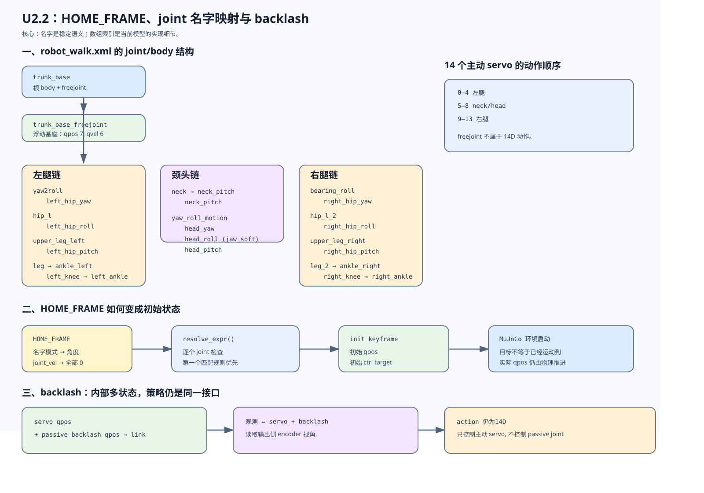

# U2.2 图解: HOME_FRAME, joint 名字映射与 backlash

本图解总结当前 Microduck walk 模型中 `HOME_FRAME` 的名字匹配、主动关节索引视图, 以及 backlash 变体的内部状态与策略接口.

## 图中核对范围

- 模型: `src/mjlab_microduck/robot/microduck/robot_walk.xml` 与 `robot_walk_backlash.xml`.
- 配置: `src/mjlab_microduck/robot/microduck_constants.py` 的 `HOME_FRAME`、`BACKLASH_HOME_FRAME`.
- 映射: 当前 mjlab `EntityCfg.InitialStateCfg` 与 `resolve_expr()` 的先匹配优先规则.
- 任务代码: `src/mjlab_microduck/tasks/mdp.py` 的 `_servo_joint_ids()`、`_servo_joint_pos()` 与 backlash encoder 观测函数.

这是结构和数据流图, 不是动力学实验或策略 rollout 结果.
