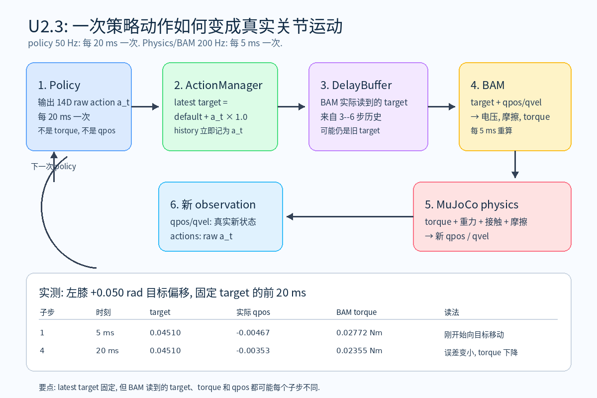
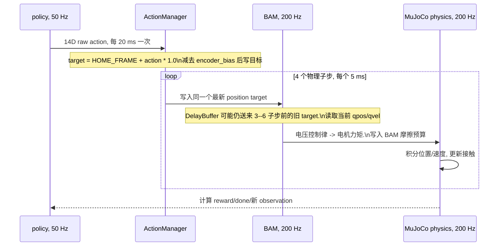
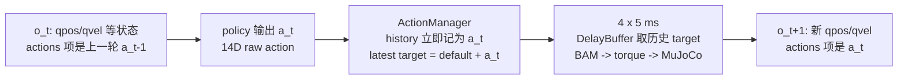

# U2.3 图解: 一次策略动作如何经过 BAM 进入物理仿真

本图解对应当前 velocity 配置. 它说明一个 14D 策略输出在一个 environment step(环境步) 中的时间关系, 不表示真实 rollout, 也不替代动态实验。

## 先记住这四句话

1. policy 每 20 ms 输出一次 14D raw action, 它是相对默认姿态的关节目标偏移, 不是力矩.
2. ActionManager 在四个物理子步内都写同一个 latest target, 但 DelayBuffer 可能让 BAM 暂时读到 3--6 步前的旧 target.
3. BAM 每 5 ms 用延迟后 target 与当前 `qpos`/`qvel` 计算电压、摩擦和 torque; MuJoCo 再用 torque 与环境物理推进新状态.
4. 下一帧 observation 的 `actions` 项保存 raw `a_t`, 而非 BAM 实际读到的 target 或 torque. `qpos` 短时未变不能单独说明 policy 没有发动作.

PNG 由 [实验生成器](../../tools/probe_u23_bam_substeps.py) 生成并经目视检查; 同名 SVG 保留为可编辑矢量源.

## 当前源码核对

- 基础 velocity 配置 (`mjlab.tasks.velocity.velocity_env_cfg.make_velocity_env_cfg`) 指定 `timestep=0.005` 和 `decimation=4`. 因而 physics step(物理步) 为 5 ms / 200 Hz, environment step 为 `0.005 * 4 = 0.020 s` / 50 Hz.
- Microduck velocity factory 保留该 action 结构, 并将 `joint_pos_action.scale` 设为 `1.0`. `use_default_offset=True`, 所以 raw action 不是力矩, 而是相对 `HOME_FRAME` 默认关节角的偏移量.
- `ManagerBasedRlEnv.step()` 每个 environment step 只调用一次 `process_action()`, 但循环四次调用 `apply_action()`, `sim.step()` 和 entity 更新. ActionManager 写入的最新 target 在这四次中不变, 当前物理状态与 BAM 输出力矩则每个子步重新计算.
- `BamActuator` 是 XL330 的 m6 电压控制、反电动势和负载相关摩擦模型. 项目当前配置将 `delay_min_lag=3`, `delay_max_lag=6`, 因而 BAM 的 DelayBuffer 每个物理子步可能把 15--30 ms 前的 target 送入控制律. 所以“ActionManager 当前写入的 target”与“BAM 此刻实际读取的 target”可能不同.

这里的最新目标、BAM 延迟后实际读取的目标、真实关节位置和电机力矩是四种不同量: policy 给最新目标, DelayBuffer 选择一段历史目标, BAM 根据该目标与当前状态计算力矩, MuJoCo 再用力矩、重力、接触和摩擦推进状态. 图中“同一个最新 target”不表示同一个力矩, 也不保证 BAM 马上读取它.

## 核对入口

- `src/mjlab_microduck/tasks/microduck_velocity_env_cfg.py`: Microduck velocity factory 的 `joint_pos_action.scale = 1.0`.
- `src/mjlab_microduck/robot/microduck_constants.py`: XL330 m6 BAM 参数与 3--6 子步延迟.
- 当前安装的 `mjlab.tasks.velocity.velocity_env_cfg.make_velocity_env_cfg`: `timestep=0.005`, `decimation=4`.
- 当前安装的 `mjlab.envs.ManagerBasedRlEnv.step`, `ActionManager.process_action` / `apply_action`, `JointPositionAction.apply_actions`, `bam.mjlab.BamActuator.compute`.

本节包含源码阅读、时间关系图解和下方的单关节 CPU 动态验证. 没有运行训练好的策略 rollout.

## 四个子步的实际 CPU BAM 记录

2026-09-14, 导师使用项目 `scripts/infer_policy.py` 的 CPU MuJoCo/BAM 排演路径, 从站立初态令 `left_knee` 的 position target 比默认姿态增加 `+0.050 rad`. BAM 使用与训练一致的 XL330 m6、`kp_fw=200`、5 ms timestep; 为隔离本节主题, 本次固定 `vin=7.4 V`、`vin_drop_gain=0.0`, 没有模拟随机命令延迟或 domain randomization(域随机化). 它不是策略 rollout, 也不是稳定性测试.

| 子步 | 时刻 | target | 实际 `qpos` | 实际 `qvel` | BAM torque |
|---:|---:|---:|---:|---:|---:|
| 1 | 5 ms | 0.04510 rad | -0.00467 rad | 0.0451 rad/s | 0.02772 Nm |
| 2 | 10 ms | 0.04510 rad | -0.00436 rad | 0.0624 rad/s | 0.02545 Nm |
| 3 | 15 ms | 0.04510 rad | -0.00398 rad | 0.0767 rad/s | 0.02445 Nm |
| 4 | 20 ms | 0.04510 rad | -0.00353 rad | 0.0893 rad/s | 0.02355 Nm |

四行的 target 完全相同, 但 `qpos` 逐步接近目标, BAM torque 则随位置误差缩小而下降. 这直接说明 policy 一次输出并不等于“一次固定力矩”. 完整原始记录见 [CSV](u2-3-left-knee-substeps.csv); 可复现脚本为 [`probe_u23_bam_substeps.py`](../../tools/probe_u23_bam_substeps.py).

## command delay: BAM 何时真正看到新 target

当前训练配置的 `delay_min_lag=3`, `delay_max_lag=6`, `delay_update_period=0`, `delay_hold_prob=0.0`. 这表示 BAM 每个 physics step 都从 3--6 中重新抽取一个历史长度, 然后从缓冲区取对应年龄的 target; 默认每个并行环境独立抽样. 它不是每个 episode 固定一个 3--6 步延迟.

为了看清边界, 下表暂时把延迟固定成 3 或 6 步, 并预先用旧 target 填满缓冲区. 在 t=0 写入新 target 后:

| 固定延迟 | BAM 在前 4 个子步读到的 target | 首次读到新 target | 已经过时间 |
|---:|---|---:|---:|
| 3 步 | 旧, 旧, 旧, 新 | 第 4 子步 | 15 ms |
| 6 步 | 旧, 旧, 旧, 旧 | 第 7 子步 | 30 ms |

第 4 子步在同一个 20 ms environment step 内, 第 7 子步已在下一次 policy 输出之后. 因此 policy 不可假设“我刚输出的动作会立即影响下一帧状态”. 训练加入这种随机延迟, 是为了让策略对真实机器人中通信、总线与执行器响应的时序不确定性保持鲁棒, 而非只适应仿真中的零延迟执行器. 固定边界的完整记录见 [delay CSV](u2-3-delay-boundaries.csv); 真实训练会在这两个边界之间每个物理步重采样.

## 一次完整 environment step: policy 实际看见什么

以下是一个普通、未触发 reset 的 20 ms step. 令 `o_t` 是 policy 已拿到的 observation, `a_t` 是它这次输出的 14D raw action.

当前 velocity actor 的 `actions` observation 项调用 `mdp.last_action`, 即 `env.action_manager.action`. `process_action(a_t)` 在缩放/偏移之前就把 raw `a_t` 写入该 history, 而 observation 在四个物理子步完成后计算. 所以对普通未 reset 的环境, `o_{t+1}` 同时包含:

- 经过四个物理子步后的 `qpos`/`qvel`, 反映真实物理响应.
- 刚刚请求的 raw `a_t`, 告诉 policy “上一轮我要求了什么”.

它**不**直接包含 BAM 此刻延迟后采用的 target 或实际 torque. 因而若 `o_{t+1}` 的 `qpos` 变化很小, 不能只凭这一点断定 policy 没有发动作: 可能是 command delay, 也可能是惯性、接触或摩擦限制了短时间响应. 若环境在这一步 termination(终止)并自动 reset, 返回的是 post-reset observation, action history 会被清零, 不应把它按上述普通链解释.
