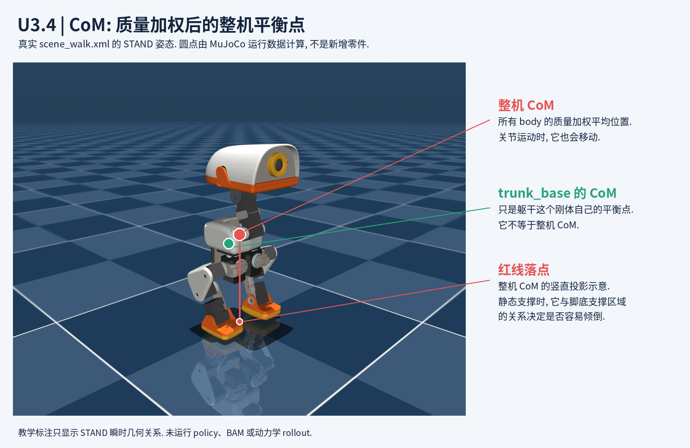

# U3.4 图解: CoM 与支撑

图片由当前 `scene_walk.xml` 的 `STAND` 关键帧渲染。红点是 MuJoCo 计算的 `trunk_base` 整棵子树的质量加权 CoM, 绿点是 `trunk_base` 单个刚体自己的 CoM; 红线是整机 CoM 到地面的竖直投影示意, 三者都不是新加的 body、site 或传感器。

导师静态核对: 此姿态下 `trunk_base` 质量为约 `0.199 kg`, 整机质量约 `0.737 kg`; 整机 CoM 世界坐标约为 `(0.00056, -0.00001, 0.14175) m`. 数值只说明该模型/该姿态的瞬时几何关系, 不代表真实机器人测量值或策略 rollout 指标。

当前 velocity 配置的 `randomize_com` 修改的是 `trunk_base` 的 `body_ipos`, 即躯干刚体自身的局部惯性中心位置, 不是把整机 CoM 直接平移同样距离, 也不会移动外观 mesh 或改写 `qpos`. 整机 CoM 的变化还要按质量比例和当前关节姿态共同决定。

生成器: [render_u34_com.py](../../tools/render_u34_com.py)。复现命令: `MUJOCO_GL=egl .venv/bin/python docs/learning/tools/render_u34_com.py`。渲染仅调用 MuJoCo `mj_forward`, 未运行 policy、BAM、接触动力学或训练。
