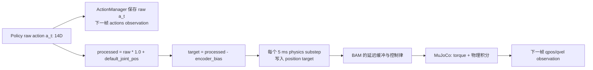
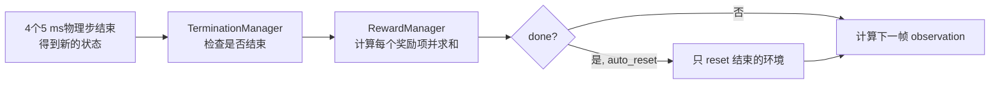
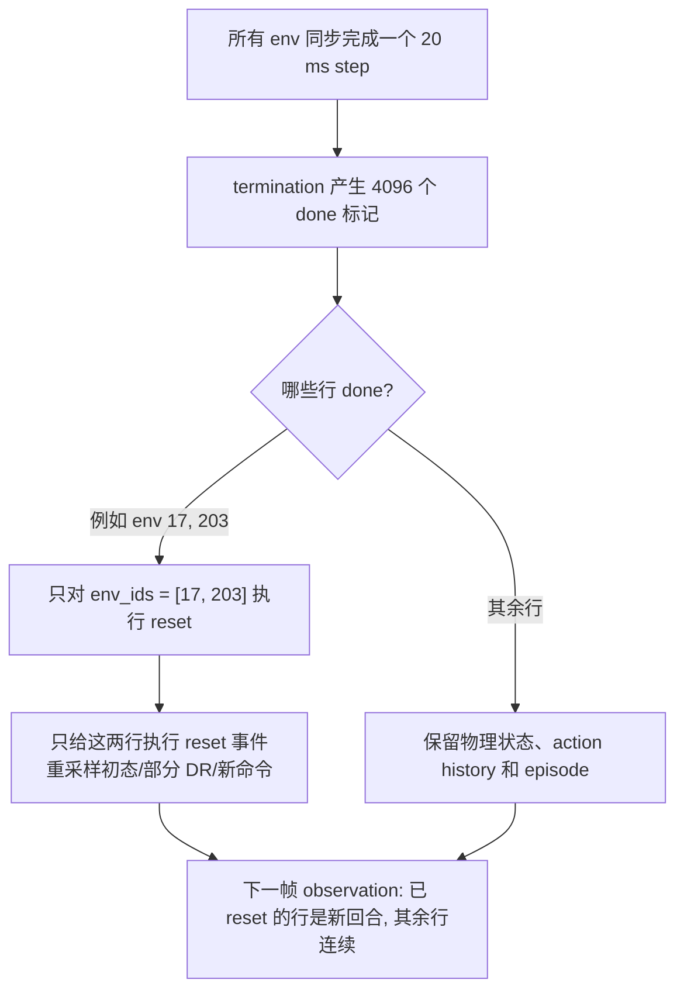

# Session 3: Policy 看到的 61D 输入从哪里来

- 日期: 2026-09-15.
- 单元/小节: U3.1 Command 与 Observation.
- 状态: 进行中.
- 入口: 用户明确要求开始 U3. 从 U2.3 的 `raw action -> BAM -> 物理状态` 接到 policy 下一次读取的数据.

## 本节实际讲了什么

本节只解决第一个主问题: 当前 velocity policy 在每个 20 ms control step 实际读到什么, 以及它与 critic 的训练输入为什么不同.

actor observation 是部署时 policy 的输入合同, 总长固定为 61D:

```text
base_ang_vel(3) + projected_gravity(3) + joint_pos(14) + joint_vel(14)
+ last_raw_action(14) + [twist(3), head_pose(4), body_pose(6)] = 61
```

其中 48D 是机器人本体感知和上一帧 raw action, 最后的 13D 是命令块. 命令块的固定顺序是 `twist -> head_pose -> body_pose`; 不使用某一类命令的任务仍保持槽位并填零, 不能删除或另改语义. 这使 runtime 能对同一家族的 ONNX policy 使用相同 61D 缓冲区.

三个 command term 都是每个并行环境各自采样并在重采样前保持的目标, 不是从传感器量到的状态: `twist` 为机体坐标系 `[vx, vy, yaw_rate]`, `head_pose` 为四个颈头关节相对 HOME 的增量, `body_pose` 为 `[x, y, z, roll, pitch, yaw]` 的标称身体姿态增量. 当前 velocity 初始范围分别为 `vx [-0.4, 0.4] m/s`, `vy [-0.3, 0.3] m/s`, `yaw_rate [-1.0, 1.0] rad/s`; 头部和身体命令从小而非零的范围开始, 后续由 curriculum 扩大.

actor 故意不读取 `base_lin_vel`: 真机没有同等的可靠真实线速度输入. critic 在训练时可以额外看到它, 以及足部高度、腾空时间、接触和接触力等特权信息, 用来更好地估值; 这些 critic-only 项不进入部署的 actor policy. CV 类比中, actor 像上线模型只能读到的输入, critic 像训练期可使用的附加标注/真值, 但两者不是固定数据集上的两套样本, 而是同一时刻同一环境的不同视图.

噪声和归一化也属于不同层: actor 的 IMU 派生项、关节位置/速度会加测量噪声, IMU 项还有 0--1 control-step delay, `joint_vel` 固定滞后 1 control-step; critic 保留更接近真值的视图. `obs_normalization=True` 则是 neural network 前对已组装 observation 的统计缩放, 不是模拟传感器误差. 导出 ONNX 时必须烘焙这一 normalizer.

## 源码与证据

- `src/mjlab_microduck/tasks/microduck_velocity_env_cfg.py`, `make_microduck_velocity_env_cfg`: 删除 actor `base_lin_vel` 与两组 `height_scan`; 给 critic 加回 `base_lin_vel`; 配置 actor 噪声/延迟、passive joint 过滤、三个 command term 和 `head_command`/`body_command` 追加顺序.
- `src/mjlab_microduck/tasks/mdp.py`, `UniformPoseCommand` 与 `zero_command_padding`: 4D/6D pose command 的独立均匀采样、精确零命令桶和保持 61D 槽位的原因.
- 导师以当前 `.venv/bin/python` 构建 `make_microduck_velocity_env_cfg()` 后核对: actor 项依次为 `base_ang_vel`, `projected_gravity`, `joint_pos`, `joint_vel`, `actions`, `command`, `head_command`, `body_command`; actor 的 `joint_vel` lag 为 1, actor IMU 项 lag 为 0--1. critic 额外含 `base_lin_vel`, `foot_height`, `foot_air_time`, `foot_contact`, `foot_contact_forces`.

## 练习与理解检查

- 用户回答: “真机部署时看不见 `base_lin_vel`, 只在训练环境用于价值估计, critic 不会部署在真机上”; “保留填0, 保证模型统一”.
- 判定: 两点均正确, 达到用户复述级证据. 更精确地说, `base_lin_vel` 是 critic 的训练期特权信息, 不应让会被导出部署的 actor 依赖它; 6D 零填充保持共享 61D 输入布局和各槽位语义, 而不仅是模型结构“看起来统一”.
- 本节未运行 checkpoint rollout 或训练. 后续再将一个真实 observation tensor 按上述分块打印, 然后固定 command 做短 rollout 作为 U3.5 的评估基线.

## U3.2: 14D raw action 如何成为关节目标

每个 environment step, policy 输出一个 14D raw action `a_t`. 当前 velocity 使用一个 `joint_pos` action term, 它的14个分量按 servo 顺序对应关节. 这不是14个 torque, 而是相对 HOME/default joint position 的位置偏移.

### 先分清六种不同的量

| 名称 | 本例的 `left_knee` 数值 | 谁持有它 | 它表示什么 |
|---|---:|---|---|
| raw action `a_t` | `+0.0500` | policy / ActionManager | policy 本次决定施加的相对偏移, 未加 HOME, 未校正 bias |
| processed action | `+0.0451 rad` | `JointPositionAction` | `a_t * scale + default_joint_pos` 后的位置目标表达 |
| 写入 position target | `+0.0351 rad` | Entity / BAM 输入链 | processed action 减 encoder bias 后的模型坐标目标 |
| BAM 实际读取 target | 可能仍为旧 target | BAM DelayBuffer | 3--6 个 physics step 延迟后进入控制律的历史 target |
| `qpos` | 由物理决定 | MuJoCo state | 关节此刻实际到了哪里, 不保证等于任一 target |
| BAM torque | 由每子步控制律决定 | BAM / MuJoCo | 由位置误差、速度、电压、摩擦等共同决定的实际力矩 |

因此, “action”一词若不加限定很容易混淆. 在 U3 的 actor observation 中 `actions` 明确指第1行 raw action, 不是后五行任意一种量.



`ActionManager.process_action()` 每 20 ms environment step 调用一次: 先更新 `prev_prev_action <- prev_action <- action <- a_t`, 再把该14D slice 交给 `JointPositionAction`. 当前 Microduck velocity factory 将 `scale` 设置为 `1.0`; `JointPositionActionCfg.use_default_offset=True`, 因而运行时 offset 是每个关节的 `default_joint_pos`, 不是配置中写死的0. 随后 `JointPositionAction.apply_actions()` 还会减去 per-environment encoder bias, 再写入物理实体的 position target.

可将当前 action mapping 看作下面三段式. 在 velocity 配置中 `scale=1.0`, 所以数值上 raw action 的一个单位就是相对 HOME 的一弧度偏移; 这不代表 policy 在直接输出一个绝对角度.

```text
raw action a_t
    -> processed = a_t * 1.0 + default_joint_pos
    -> position_target = processed - encoder_bias
```

`default_joint_pos` 是模型初始化时由 `HOME_FRAME` 解析得到的标称关节姿态. 它让 raw action 的0表示“请求 HOME”, 而不是“请求世界中的0 rad”. 例如两侧 hip_roll 和 hip_pitch 的 HOME 本来就不是0; 若去掉 default offset, policy 输出零会把它们错误地拉向机械零位而非站姿.

encoder bias 的减法也有明确的坐标含义. 若编码器读数可写成 `measured = true_position + bias`, 而 action 链希望测得的目标为 `processed`, 则应写入物理模型的真值坐标是 `true_target = processed - bias`. 这让训练中的 encoder 偏差随机化与执行目标处在一致的测量约定中, 而不是让 policy 看到一套带偏差的观测、reward/执行却使用另一套不对应的目标.

一个数值例子: `left_knee` 是 servo 顺序第4个分量 (0-based index 3), HOME/default 位置为 `-0.0049 rad`. 若 policy 在该分量输出 `+0.0500`, 本环境 encoder bias 为 `+0.0100 rad`, 则 `processed = -0.0049 + 0.0500 = 0.0451 rad`, 写入的 target 为 `0.0451 - 0.0100 = 0.0351 rad`. raw action history 记录的仍是 `+0.0500`, 而不是两个 target 数值, 更不是 BAM torque.

同一个 `a_t` 在四个 5 ms physics substep 中会被 `apply_action()` 重复写入, 但这不表示 BAM 必然立刻采用该 target: U2.3 已核对 BAM 另有3--6个 physics step 的 command delay. 即便它已采用新目标, torque 与 `qpos` 仍会随每个子步的实际状态、接触与执行器动力学变化.

### 一次正常、未 reset 的 20 ms step

| 时刻 | 环境做什么 | 哪些量更新 |
|---|---|---|
| `t=0 ms` | policy 读取 `o_t`, 输出 `a_t`; `process_action(a_t)` 只执行一次 | raw action history 立即变为 `a_t`; processed action 已算好 |
| `0--5 ms` | 第1个 physics substep: `apply_action -> sim.step` | position target 被写入; BAM 可能还读旧的延迟 target; `qpos/qvel/torque` 改变 |
| `5--10 ms` | 第2个 substep | 同上, 物理状态继续推进 |
| `10--15 ms` | 第3个 substep | 同上 |
| `15--20 ms` | 第4个 substep | 同上; 固定 lag=3 时新 target 首次可进入 BAM 控制律 |
| `20 ms` 后 | termination、reward、command/event、sensor、observation 依次计算 | 正常环境返回 `o_{t+1}`; 其中 `actions=a_t`, 但 `qpos/qvel` 是四次物理步后的实际状态 |

若此 step 触发 termination 或 time-out 且 `auto_reset=True`, 环境会在 observation 前 reset 对应的并行环境, action history 也会清零. 所以“`o_{t+1}.actions` 等于 `a_t`”只适用于正常、未 reset 的环境; 这是阅读 rollout 时必须先检查 done 的原因.

### 为什么 observation 保存 raw action, 而不保存 BAM 的延迟 target

这是当前 `mjlab.envs.mdp.observations.last_action()` 的明确实现: 它直接返回 `env.action_manager.action`, 即 ActionManager 保存的最新 raw policy output. 这样 actor 看到的是“自己上一轮决定了什么”, 与 policy 的14D输出保持一一对应且不受每环境、每 physics step 随机 delay 的内部细节改变。

从控制角度看, 这也让 policy 能把“上一轮意图”与当前带延迟、带噪声的 `joint_pos/joint_vel` 合在一起判断结果. 它不能从 `actions` 一项单独知道 BAM 此刻读到哪条历史 target; 这正是 domain randomization 希望它面对的执行不确定性, 而不是被一个仿真专用的内部真值捷径绕开. 这段是基于当前观测语义的工程解释; 源码直接保证的事实是 `last_action()` 返回 raw action.

## U3.2 源码与证据

- `src/mjlab_microduck/tasks/microduck_velocity_env_cfg.py`, `make_microduck_velocity_env_cfg`: 当前 `joint_pos` action 的 `scale=1.0`.
- `src/mjlab_microduck/robot/microduck_constants.py`, `HOME_FRAME`: `left_knee` 的 default joint position 是 `-0.0049 rad`.
- 当前安装依赖 `mjlab.envs.mdp.actions.actions.BaseAction.process_actions` 和 `JointPositionAction.apply_actions`: raw action 先做 affine 变换, position target 再减 encoder bias.
- 当前安装依赖 `mjlab.managers.action_manager.ActionManager.process_action`/`apply_action`, `mjlab.envs.manager_based_rl_env.ManagerBasedRlEnv.step`: raw action 每个20 ms保存并处理一次, processed target 在4个5 ms physics substep 被写入; `last_action()` 返回的是 raw action.

## U3.2 练习与理解检查

- 待用户回答: 沿用上例, `a_t[left_knee]=+0.0500`, default 为 `-0.0049 rad`, encoder bias 为 `+0.0100 rad`. 下一帧 `actions` observation 的该分量是多少? 写入 position target 又是多少? 它们为何不同?
- 本节未运行新脚本、rollout 或训练. 该数值例子是依据当前配置和源码的手算, 不是动力学实验.

### 补充讲解: 每个词先有“身份”, 再有公式

用户指出此前一次引入了 `encoder bias`、`processed action`、`measured_position` 等许多术语, 但没有先解释它们是什么. 这是导师讲解不足, 不应把源码变量名直接当作已经理解的概念. 以下按一个膝关节重新建立最小词汇表; 本段不要求用户立刻计算或回答练习.

#### A. 机器人和传感器中真实存在的东西

1. **关节真实位置 `true_position` / 仿真中的 `qpos`**: 膝盖此刻真正转到了哪个角度. 在 MuJoCo 中这个物理真值存为 `qpos`; 真机也有真实角度, 但软件不能直接无误差地看见它.
2. **编码器 encoder**: 安装在舵机上的角度传感器. 它给控制软件一条“我认为关节在这里”的读数. policy 在真机上依赖的就是这类测量, 不是仿真内部的 `qpos` 真值.
3. **测量值 `measured_position`**: 编码器报出的角度. 这是解释误差时用的数学名字, 不是本项目额外装了一个叫 measured_position 的硬件或数组.
4. **编码器偏差 `encoder_bias`**: 某只编码器的固定标定误差, 是一个带正负号的小数. 例如真实角度是 `0.030 rad`, bias 是 `+0.010 rad` 时, 编码器报 `0.040 rad`; 即 `measured_position = true_position + encoder_bias`. 当前 velocity 训练会按并行环境随机此偏差, 让策略不只适应一台“完美校准”的模拟机器人.
5. **力矩 torque**: 电机实际施加给关节的扭转力. 它能推动关节, 但不保证关节瞬间到达目标; 重力、接触、惯性和摩擦都会共同影响接下来 `qpos` 怎样变化.

#### B. 控制软件为了下命令而创建的量

1. **HOME / `default_joint_pos`**: 机器人标准站姿中每个关节应有的角度, 是一个参考姿势. 例如 `left_knee` 的 HOME 是 `-0.0049 rad`, 并非所有关节都是0. 这不是当前实际姿势, 只是“默认从哪里开始理解动作”的参考点.
2. **raw action**: policy 神经网络刚输出的14个数字. 对这个环境而言, 每个数字表示相对 HOME 的请求偏移. raw action 为0的意思是“目标保持 HOME”, 不是“直接输出0力矩”, 也不是“当前关节已经在HOME”.
3. **scale**: 将 policy 的输出幅度换算为控制幅度的系数. 当前 velocity 的值是1.0, 所以此处没有额外缩小或放大; 其他任务可以使用不同值. scale 不是传感器, 不是机器人状态, 只是配置中的换算规则.
4. **processed action**: 软件内部中间结果, `raw action * scale + default_joint_pos`. 它没有独立物理含义, 不会被传感器测到, 也不是多了一个机器人部件; 给它这个名字只是为了把“相对偏移”变成“以模型关节坐标表达的目标角度”.
5. **position target**: 最终交给位置控制器的“希望关节去哪里”的角度. 它仍是目标, 不是 `qpos`, 也不是 torque. 在当前实现中, 它等于 processed action 再减 encoder bias 后的值.
6. **BAM 延迟后实际读取的 target**: 由于模拟真实命令传输延迟, BAM 此刻可能还在使用较早一轮的 position target. 这也不是一个新传感器读数, 而是控制器内部从命令历史中取出的旧命令.

#### 一个只含一个关节的完整小故事

先忽略14D, 只看 `left_knee`:

```text
HOME/default:                 -0.0049 rad
当前真实关节位置 qpos:          +0.0200 rad
encoder bias:                 +0.0100 rad
编码器测量值:                   +0.0300 rad
policy 输出 raw action:         +0.0500
软件中间值 processed action:    -0.0049 + 0.0500 = +0.0451 rad
写入 position target:          +0.0451 - 0.0100 = +0.0351 rad
```

先读这段的因果顺序: 当前 `qpos=0.0200` 是机器人已经处在的真实状态; 因为 encoder 有 `+0.0100` 的偏差, 它把这个状态报告成 `0.0300`. policy 从观测中接收的是这类测量, 再输出 `+0.0500` 这个相对 HOME 的请求. 软件先把请求换成以 HOME 为基准的目标 `0.0451`, 再做偏差校正, 让写入物理模型的 target 为 `0.0351`. 随后 BAM 和 MuJoCo 才会尝试让实际 `qpos` 向该 target 演化; 不会在这一行算完后瞬移到 `0.0351`.

这个例子中有两个“位置”尤其不能混淆: `qpos=0.0200` 回答“现在实际在哪里”, position target=`0.0351` 回答“控制器希望之后往哪里去”. HOME=`-0.0049` 则只回答“policy 的零动作以哪个标准姿势为基准”.

后续讲解约定: 每次先说明一个新量属于“物理状态、传感器测量、控制目标还是纯软件中间变量”, 再说明它在时间线上何时更新; 没有先定义的缩写和变量不直接堆入公式.

### 用户确认与追问: 为什么要把上一帧 raw action 放回 observation

- 用户回答 position target 是“控制器希望它之后去的位置”. 判定正确, 达到该定义的用户复述级证据.
- 用户随即追问: policy 明明已经输出过 `a_t`, 为什么下一帧还要把上一帧 raw action 放进 observation?

先纠正一句日常语言: policy 不像人一样天然记得“我刚才做了什么”. 当前 actor 是以 observation 为输入、输出 action 的前馈网络配置; 每次调用可抽象为 `a_t = policy(o_t)`. 到下一次调用时, 若没有在 `o_(t+1)` 中提供历史, 它只会收到当前那一帧传感器状态, 不会自动携带上次输出的 `a_t`.

`actions` 这14D因此是一个明确加入的“一步记忆”: 正常未 reset 时, `o_t.actions = a_(t-1)`, policy 据此输出 `a_t`; 返回的 `o_(t+1).actions` 则更新为 `a_t`. 当前源码的 `last_action()` 明确返回 ActionManager 保存的 raw policy output.

为什么这个记忆有价值: 执行器存在3--6个 physics step 的随机命令延迟. 完全可能出现两个环境此刻 `qpos`、`qvel` 看起来相同, 但环境A上一轮的 raw action 是“膝盖朝正方向动”, 环境B上一轮是“朝负方向动”. A的延迟队列里可能正有正方向命令将到达BAM, B则可能有反方向命令将到达; 两者下一小段时间的运动趋势不同. 若 policy 只看当前姿态和速度, 它会把这两个不同的控制情形误认为同一个 observation. 上一帧 raw action 告诉它“我刚刚发出的意图是什么”, 帮它结合新的关节测量判断应继续、减弱还是反向。

raw action 不会泄露 BAM 当前精确读取哪条延迟命令: 延迟长度仍是执行器内部的随机非理想性, actor 必须通过反馈适应. 这正符合 domain randomization 的目的. 同时, 保留上一帧 raw action 也让 policy 能直接比较本次候选动作与上次意图; 这与训练中的 action-rate 平滑惩罚形成一致的输入/优化约定, 但 action history 本身不是该惩罚的唯一计算来源.

本段为导师讲解, 用户尚未用自己的话复述为何“同样 qpos/qvel 但不同上次命令”会导致不同未来, 因此不升级为该主题的掌握证据.

### 用户追问: 为什么不存更多 action history

用户问“存越多不是越好吗”. 结论不是绝对的“越多越好”, 而是要让历史长度匹配真正未被当前测量解释的动态, 并承担它带来的接口和训练代价.

先区分两个层面:

1. **环境内部已经保存多帧**: 当前 `ActionManager` 有 `action`、`prev_action`、`prev_prev_action` 三个14D raw action buffer. 项目的一些 action-rate/action-acceleration reward 也维护自己的前一帧或前两帧缓存, 用于计算平滑惩罚.
2. **actor 被公开给几帧**: actor observation 的 `last_action()` 只返回 `ActionManager.action`, 即最新一帧 raw action. 所以 actor 只额外看见14D的一步 history, 不是因为旧帧不存在.

更多 history 何时可能帮助: 如果有较长的通信延迟、滤波器、执行器热状态等隐状态, 当前 `qpos/qvel` 无法区分“刚发过正命令”和“刚发过负命令”, 则较早命令可能继续提供线索。它的作用类似给前馈网络一段短视频帧, 让它从时间变化推断当前单帧看不见的状态。

但它有四类成本:

1. **输入维度和共享接口**: 现有 actor 是61D, 已含一帧14D raw action. 再公开一帧会成为75D, 再加两帧会成为89D. 这会打破本项目共享的61D ONNX/runtime 合同, 旧策略不能热切换, 部署端也必须改成维护同样长度和顺序的 history。
2. **学习负担**: 较早的动作常已被当前 `qpos/qvel` 吸收. 把大量重复或过时特征喂给有限训练数据, policy 还要学会何时忽略它们, 不保证收敛更快或行为更好。
3. **训练/部署一致性**: 若训练看到三帧动作, 真机 runtime 也必须在 reset、掉包、策略切换时精确维护三帧相同语义的 raw action history. 只在仿真里多存而部署端不匹配会破坏 sim2real。
4. **并非真正解决全部隐状态**: 即使存更多 raw action, actor 仍不知道 BAM 在此刻精确取到了 delay buffer 的哪条 target. 盲目加很多帧不如先测量到底是哪种隐藏动态导致问题, 再决定历史长度、是否使用可部署的传感器量, 或是否设计有明确状态的 recurrent policy.

结合当前项目的数字: BAM delay 为3--6个5 ms physics step, 即15--30 ms, 约0.75--1.5个20 ms control step. 现有设计选择一帧 raw action 加当前 `qpos/qvel` 作为轻量提示, 与这段短延迟量级相符; 这不是“数学上已证明一帧永远最优”, 而是当前61D共享接口下的工程选择. 若评测显示策略确实因更长未观测延迟失败, 才应提出独立接口方案、重新训练并同时修改 runtime, 而不是悄悄给当前策略族加维度。

### 用户复述: `actions` 14D 补什么信息

- 用户回答: “是不是解决了历史状态的信息?”
- 判定: 方向正确, 但需精确为“补充上一帧的历史控制意图/raw action”, 而不是保存过去的 `qpos/qvel` 等完整历史状态. 当前测量中的 `qpos/qvel` 描述现在实际状态, `actions` 描述刚刚下达、可能因BAM延迟尚未完全反映到状态中的命令. 该澄清后达到用户复述级证据.

## U3.3: 这一 step 得多少分, 为什么结束

### 先定义本节的新词

- **reward(奖励)**: 环境在每个20 ms control step 给 policy 的学习信号. 它不是机器人主观感受, 也不等同于“任务已经成功”; 它是在训练中用来引导 policy 改善行为的数值.
- **reward term(奖励项)**: 一条独立的评分规则, 例如“速度是否接近命令”或“动作是否突然跳变”.
- **raw value(原始分数)**: reward term 根据当前物理状态算出的值, 还未乘该项权重. 不同项的范围和单位可以不同.
- **weight(权重)**: 人为指定的乘数, 决定某项对总 reward 的方向和相对重要性. 对“越小越好”的 cost(代价), 通常使用负权重, 使它贡献负 reward.
- **step reward(单步奖励)**: 本项在当前一个20 ms step 真正加进总 reward 的数值. 当前 mjlab 默认还乘 `dt=0.02 s`, 即 `step contribution = raw value * weight * 0.02`.
- **episode(回合)**: 一个并行环境从 reset 到下一次结束之间的一段连续交互. 当前 velocity 最多20秒, 即1000个 control step.
- **termination(终止)**: 环境判断这个 episode 已不能或不应继续. 它是一个布尔判断, 不等于 reward 项.
- **reset(重置)**: 为结束的那一个并行环境重新采样命令/随机化并回到初始状态. 其他未结束的并行环境继续运行.

### 一步的真实顺序



当前 `ManagerBasedRlEnv.step()` 先做四个物理子步, 然后检查 termination, 再计算 reward, 最后对结束的环境 reset, 并返回 observation. 因此发生摔倒的那个最后物理状态仍会获得本 step 的 reward, 但若 auto-reset 开启, 返回给 policy 的 observation 已是新 episode 的初始 observation. 读 rollout 时, reward/done 与返回 observation 要一起看.

### 用当前 velocity 的三个奖励项看“原始分数 -> 单步贡献”

#### 1. `track_linear_velocity`: 是否按命令走

这项读取 `twist` command 的 `[vx, vy]` 和机器人躯干在 body frame 的实际线速度. 它算两者误差的平方, 再用一个 Gaussian(高斯形分数)把“误差小”变成接近1、“误差大”变成接近0的分数. 当前 `std = sqrt(0.1) ≈ 0.316 m/s` 是这项开始明显变差的误差尺度, 不是速度上限.

当速度完全匹配时 raw value 为1. 当前权重为 `+2.0`, 所以本项每个20 ms最多贡献 `1 * 2.0 * 0.02 = +0.04`. 若误差变大, raw value 降低, 这份正奖励就变少. 它在教 policy “完成给定的速度指令”, 不是直接判定“走路已合格”.

#### 2. `upright`: 躯干是否接近直立

这一项从 `trunk_base` 的方向计算倾斜程度. 躯干竖直时 raw value 接近1, 倾得越多越接近0. 当前 `std = sqrt(0.05) ≈ 0.224` 是倾斜容忍尺度, 当前权重同样为 `+2.0`, 因而理想直立时也最多贡献 `+0.04` 每 step.

它的作用是防止 policy 为了得到速度奖励而长期前扑/侧倒. 但它不是 termination: 轻微倾斜仍可继续获得一部分 upright reward, 只有超过终止阈值才结束 episode.

#### 3. `action_rate_l2`: 动作是否突然跳变

这一项不看关节实际位置, 而看连续两次 raw policy action 的差:

```text
raw value = sum_over_14_joints((a_t - a_(t-1))^2)
```

它是一个 cost: 差为0时 raw value为0, 跳变越大值越大. 当前初始权重为 `-0.1`, 所以它必然贡献0或负数. 例如14D差的平方和为1时, 单步贡献为 `1 * (-0.1) * 0.02 = -0.002`. 这就是为什么 W&B 中这类 penalty 的 `Episode_Reward/action_rate_l2` 应不大于0; 若它持续为正, 通常意味着权重或函数符号用反了.

当前训练会通过 curriculum 后续提高这项负权重, 但本节先只理解“它是对 raw action 突变收费”, 不把 weight 阶段误当成行为是否已经学好的证据.

总 step reward 是所有启用项的单步贡献之和. 高总 reward 不自动证明策略走得好: 仍必须观察速度误差、跌倒、接触和视频; reward 只是训练目标的代理指标.

### `terminated` 与 `truncated` 是两种不同的结束原因

TerminationManager 逐项检查布尔条件. 所有条件的或逻辑决定 `done`, 但它保留两种标签:

| 标签 | 本项目当前例子 | 含义 |
|---|---|---|
| `terminated` | `fell_over`, `nan_state` | 物理失败或无效状态, 不能把它当作正常时间边界 |
| `truncated` | `time_out`, `out_of_terrain_bounds` | 外部设定的截止边界; 不表示任务成功, 也不必然表示物理失败 |

当前 `fell_over` 的条件是躯干倾角超过 `1.2217 rad`, 约70°. `nan_state` 防止物理数值错误传播. `time_out` 在 episode length 到1000 step时触发. `out_of_terrain_bounds` 在当前配置也标为 `time_out=True`, 因而记录成 `truncated`; 这是这条配置给训练数据的语义标签, 不应仅凭名称臆断它一定是 `terminated`.

两种标签都导致 reset, 但训练算法在处理回报估计时可以区分“物理上断掉”与“人为/外部截断”. 这一点到 U4 讲 bootstrap/GAE 时再展开; 当前只需先正确读懂 rollout 的 `terminated`、`truncated` 和总 `done`。

## U3.3 源码与证据

- 当前 `make_microduck_velocity_env_cfg()` 构建结果: `track_linear_velocity` 权重 `+2.0`, `std=sqrt(0.1)`; `upright` 权重 `+2.0`, `std=sqrt(0.05)`; `action_rate_l2` 初始权重 `-0.1`.
- 当前安装的 `RewardManager.compute(dt)`: 每项执行 `raw value * weight * dt`, `dt` 为 environment step 的 `0.02 s`.
- 当前安装的 `ManagerBasedRlEnv.step`: 四个 physics substep后依次调用 termination manager、reward manager、auto reset、observation manager.
- 当前 termination cfg: `time_out` 与 `out_of_terrain_bounds` 的 `time_out=True`; `fell_over` 与 `nan_state` 的 `time_out=False`.

## U3.3 练习与理解检查

- 用户先回答总单步 reward 为 `0.06`, 随即定位原因: 误把 `action_rate_l2` 的单步惩罚看作 `-0.02`. 实际应按 `raw value(1) * weight(-0.1) * dt(0.02)` 得 `-0.002`, 因此正确合计是 `+0.04 + 0.04 - 0.002 = +0.078`. 用户正确回答20秒时间上限属于 `truncated`. 结束类型达到用户作答级证据; 奖励算术的十倍差异已讲评, 后续读 W&B 分项时复习一次.
- 本节未运行训练或 rollout. 上述数值是根据当前 config 手算, 不是策略表现数据.

## 停在哪里, 下次做什么

进入 U3.4 Event/Curriculum, 从同一次 `step()` 追踪 startup/reset/interval 事件和并行环境独立 reset.

# U3.4 Event/Curriculum: 谁在什么时候改变哪一台机器人

## 本节主问题

一次训练不是一个机器人反复跌倒, 而是例如4096个彼此独立的 Microduck 同步执行20 ms控制步。它们共享 policy 网络和一份训练进度, 但各自保存自己的物理状态、命令、计时器、随机参数和 episode 长度。`Event(事件)` 是一条软件时序规则: 在指定时机, 对指定的一批环境做一件事。它不是 policy 输出, 也不是机器人新增的物理部件。

可以把并行状态想成一个有4096行的表: 第 `i` 行是 `env i` 的一台虚拟机器人。一次 GPU 张量运算同时处理所有行, 所以快; 每行数值仍相互独立, 所以某一行跌倒不会把其他4095行送回起点。



这里的 `env_ids` 是一组整数索引, 属于软件中用来选择“表中哪些行”的变量, 不属于机器人状态。当前 `ManagerBasedRlEnv.step()` 先得到 `reset_env_ids = done` 的行号, 只把这组行传给 `_reset_idx(env_ids)`。这个 reset 路径会重置对应的仿真/scene, 对这些行执行 reset-mode event, 并只清理这些行的 observation、action、reward、command 等 manager 缓存。

因此 `env 17` 摔倒时, `env 18` 不会被重置; 后者的 `qpos`、动作历史和本回合计时继续演化。两者在同一个 wall-clock/GPU 调用中前进一步, 不表示它们处在同一个 episode。

## 三种当前需要分清的事件时机

| mode | 它何时触发 | 当前 velocity 环境中的例子 | 它通常改变什么 |
|---|---|---|---|
| `startup` | 环境对象初始化时一次 | `expand_bam_friction_fields`, `randomize_mass_inertia`, 基础模板的 `encoder_bias` | 整次训练中固定的每环境物理/传感器差异, 或初始化运行所需字段 |
| `reset` | 某些 `env_ids` 的 episode 刚结束并重开时 | `reset_action_history`, `randomize_com`, `randomize_head_com`, `randomize_joint_friction`, `randomize_armature` | 新回合的初态, 或“这一局碰到的是哪一台变体机器人” |
| `interval` | 回合进行中, 某台环境自己的倒计时归零时 | `push_robot`, 每3--6 s一次 | 不等摔倒/重置的中途扰动 |

### `startup`: 固定但不同的“4096台机器人”

`startup` 的“一次”指环境建立时的一次, 不是每个 episode 一次。以 `randomize_mass_inertia` 为例, 当前开关开启, 它在初始化时为每个环境采样质量/惯量缩放, 范围为0.95--1.05。这意味着 env 17 可以在整次 run 中始终是一个略轻的机器人, env 18 可以始终略重; 它们不会在每次跌倒后换质量。

这类差异模拟真机之间或长期不变的差异。`encoder_bias` 也是同类: policy 会在一次训练中见到很多带不同固定标定偏差的“设备”, 而不是每一局把同一台设备的标定突然改掉。

`expand_bam_friction_fields` 名字虽在 startup, 但它不是随机化: 它为 BAM 需要的 MuJoCo 字段登记成“可按环境分别存放”。没有这一步, 后续想给4096行各写不同摩擦, 可能会错误地写到一份共享字段。

### `reset`: 只重开结束的那几行

假设 env 17 倾倒而 env 18 正常行走。对 env 17 的 reset 过程中, 当前配置会做例如:

1. reset-mode event 写入新初始 base/joint 状态, 并由 `randomize_com` 为 env 17 的躯干 CoM 采一个新偏移;
2. `randomize_joint_friction` 为 env 17 的 BAM 摩擦比例采一个新值;
3. `reset_action_history` 只清 env 17 的项目自定义平滑奖励缓存, 防止新回合把上一回合最后一个动作当作自己的历史;
4. 后续各 manager 对同一组 env_ids 清理自身缓存, 其中 command manager 为 env 17 重采样新命令。

env 18 不执行这四件事。尤其最后一点连接到 U3.2: `actions` 14D 和 action-rate 缓存是有时间含义的, 所以 reset 必须清掉结束环境自己的历史; 若把全部4096行一起清掉, 正在连续走路的环境会突然失去真实的上一帧 action。

`Domain randomization(DR, 域随机化)` 是这些事件所做工作的统称: 有意让每个环境/episode的物理或测量条件略有不同, 让 policy 学会对现实差异稳健, 而不是只记住一台完美模拟机器人。

### 非累积 DR: 每次都从标称值重新抽, 不是在旧结果上继续叠加

这是本项目特别重要的约束。以 CoM 偏移为例, 假设标称 CoM 位置为 `0 mm`:

```text
第 1 回合抽到 +2 mm  -> 最终为 +2 mm
第 2 回合抽到 -1 mm  -> 正确最终为 -1 mm, 不是 +1 mm
```

当前 `dr.body_ipos(... operation="add")` 会从编译时的标称字段读取再加新样本, 因而不会不断累计。项目自定义的 BAM 摩擦随机化也先恢复该环境的 `friction_scale=1.0`, 再采样新比例。若错误实现为“在上一局结果上继续加/乘”, 很多次 reset 后会产生训练配置范围之外的荒谬机器人, 这就是 `non-accumulating DR(非累积域随机化)` 要防的错误。

### `interval`: 同步计算, 不同步受扰

当前 `push_robot` 开启后, 每个环境在3--6 s之间独立抽下一个推力时刻。EventManager 为它保存一个长度4096的 `time_left` 张量, 每个20 ms step都一起减去 `0.02 s`; 哪些行先减到零, 就只对哪些行调用推力函数并给它们重新抽倒计时。

所以 env 17 可以在第3.2秒遭受一次速度扰动, env 18 可以在第5.7秒才受扰。两者的物理积分是同步批处理, 但遇到推力的时刻不同。只有显式把 `is_global_time=True` 才会让全部环境同一时刻受推; 当前 `push_robot` 没有这样设置, 默认是独立计时。

## Curriculum(课程) 不是一次随机抽样, 而是随训练进度改“下一次允许抽多难”

`curriculum` 属于运行中的软件调度规则, 既不是物理状态也不是传感器测量。它根据共有的 `common_step_counter` 改 Manager 当前使用的配置。例如当前 CoM 范围课程是:

| 已跨过的共享环境步数 | 下一次 reset 的 CoM 偏移范围 |
|---:|---:|
| 0 | ±3 mm |
| `500 × 24 = 12,000` | ±5 mm |
| `1000 × 24 = 24,000` | ±10 mm |
| `1500 × 24 = 36,000` | ±15 mm |

这里的“共享环境步数”每经过一个20 ms control step只加1, 不是 `4096 × 1`。`24` 来自 runner 每次 PPO iteration(迭代)每环境收集24步, 因而第一个阶段大约对应500 iteration。课程函数会读取这个全局计数, 并改写 **EventManager 中正在生效的** `randomize_com` 配置; 不应改 `env.cfg.events`, 因为 manager 初始化时已经复制了配置, 改旧声明不会影响运行中的 manager。

课程把“允许的范围”从±3 mm扩大到±5 mm, 但不把所有环境的 CoM 统一设为5 mm: 某台环境真正 reset 时仍会在该范围内独立抽样。课程也通常在某次 `_reset_idx()` 时检查并更新, 所以跨过门槛的一刻, 已经在跑的旧 episode 保持其已采样参数到自身 reset; 新 reset 的环境才使用新范围。

当前 `head_pose_bias_weight` 课程则是另一类: 它改变活跃 RewardManager 的一个 reward weight, 从训练早期的0逐段升到3.0。它不是 DR, 没有“给每台机器人抽一个不同权重”; 一旦该 live weight 被更新, 后续 reward 计算使用的是这份训练共享权重。

## U3.4 源码与证据

- `src/mjlab_microduck/tasks/microduck_velocity_env_cfg.py`: 配置 `startup` 的质量/惯量随机化和 BAM 字段展开, `reset` 的 CoM/摩擦/action history 事件, 以及默认独立计时的3--6 s `push_robot` interval 事件.
- 当前安装的 `ManagerBasedRlEnv._reset_idx(env_ids)`: 先调用 curriculum manager, 再 reset sim/scene, 并将同一组 `env_ids` 传给 `event_manager.apply(mode="reset", ...)` 和各 manager 的 reset.
- 当前安装的 `EventManager`: reset event 只调用选中 `env_ids`; interval event 在默认 `is_global_time=False` 下以每环境 `time_left` 找到到期行. `EventTermCfg` 的默认 `min_step_count_between_reset=0`, 因而当前 reset event 每次 reset 都可触发.
- `src/mjlab_microduck/tasks/mdp.py`: `com_range_curriculum` 修改 live EventManager term 的 `ranges`; `randomize_bam_friction` 先恢复标称 scale 再采样, 保证非累积.

## U3.4 练习与理解检查

假设训练已刚刚跨过12,000个共享 environment step。env 17 此刻摔倒, env 18 正在正常走路, 且 env 18 的 push 倒计时还剩0.01 s。

请分别回答:

1. 这次 reset 会传入哪些 `env_ids`, env 18 的 action history 会不会被清掉?
2. env 17 下一局的 CoM 是在什么范围内重新抽样? env 18 的 CoM 会不会因为 env 17 摔倒而立即重抽?
3. 紧接下一个20 ms step, 哪台环境可能收到 `push_robot`? 为什么?

本节为源码阅读与手工推演, 未启动训练或 rollout.

### 用户作答与讲评: reset 和 interval 时间

- 用户答第1问: `env 17`, env 18 action history 不会清掉。正确, 达到局部用户作答级证据。
- 用户答第2问: env 17 从 `±5 mm` 抽样, env 18 不会因 env 17 摔倒而立即重抽。正确, 达到局部用户作答级证据。
- 用户答第3问: 两者都不会, 并把 `0.01 s` 解释为100 ms。此处有两个错误: `0.01 s = 10 ms`, 而一个 environment step 是20 ms; 因此下一步倒计时从10 ms减去20 ms后过零, EventManager 会对 env 18 触发 `push_robot` 并重采样其计时器。env 17 刚 reset, 它的独立 interval timer 已重采样到3--6 s, 所以本例不会立刻受推。

### 用户追问: CoM 是什么

`CoM(center of mass, 质心)` 是物理系统当前质量分布的质量加权平均位置, 属于由各刚体质量和姿态推导出的物理量, 不是传感器读数、控制目标、policy 输入槽位或一个真实安装的零件。若把机器人拆成许多小块, 第 `i` 块质量为 `m_i`, 世界位置为 `r_i`, 则整机 CoM 为:

\[
  r_{\mathrm{CoM}} = \frac{\sum_i m_i r_i}{\sum_i m_i}.
\]

无需把这个公式当作新状态数组记住: 它只表达“重的部位影响更大”。头部、躯干、左右腿都在算式里; 关节一动, 每块的位置 `r_i` 改变, 整机 CoM 也随之移动。图解见 [U3.4 CoM 图](../assets/u3-4/README.md)。


图中红点是整机 CoM, 绿点是 `trunk_base` 单个刚体自己的 CoM。它们不必重合: 红点汇总全身质量, 绿点只看躯干。当前 STAND 姿态静态核对到整机质量约 `0.737 kg`, 其中躯干约 `0.199 kg`; 整机 CoM 世界坐标约 `(0.00056, -0.00001, 0.14175) m`。这些是当前模拟模型的计算值, 不是测得的真机值。

重力等价于作用在 CoM 附近的合力。机器人静态站立时, 将整机 CoM 沿重力方向投到地面得到红线落点; 该投影若位于双脚实际支撑区域内, 通常有更大的静态平衡余量。若在区域外, 在不迈步/不产生足够接触力矩的情况下会倾倒。行走是动态过程, CoM 投影可短暂离开静态支撑区域, 此时速度、角动量、接触力和下一步落脚也共同决定能否恢复, 不能把“投影在内”误当作走路成功的充分条件。

本项目 `randomize_com` 的名字容易让人误会: 当前事件调用 `dr.body_ipos` 且只选择 `trunk_base`, 实际修改的是躯干刚体内部惯性中心的局部位置 `body_ipos`, 在三个局部轴各加一个随机偏移。它不会移动机器人外观 mesh, 不会直接改 `qpos`, 更不会把整机 CoM 精确平移相同的3/5/10/15 mm。整机 CoM 的实际变化要由躯干所占质量比例和当前全身姿态决定。

从 policy 的角度, 真机没有一个可直接读取的“整机 CoM 传感器”。policy 看见的是 IMU、关节编码器等测量, 并从“同样动作下身体如何晃动、脚如何受力”间接适应质量分布。CoM DR 正是训练中偷偷改变这项物理条件, 迫使 policy 不能只适应一套完美固定的质量分布。

# U3.5 训练前评估: 先规定怎么判, 再看策略表现

## 本节主问题

`evaluation(评估)` 不是“打开 viewer 看几秒, 感觉它走得不错”。它是一套预先写清的可重复实验: 固定被测 policy、输入条件、初始条件、随机性和统计方法, 之后再报告行为结果。其目的不是替 reward(奖励) 再算一次分, 而是回答人真正关心的问题, 例如“在0.2 m/s前进命令下, 它能否持续行走20秒而不摔倒, 实际速度偏差多大”。

当前 U3 先建立基线评估思维, 不启动新训练。仓库中存在用户历史 velocity checkpoint `logs/rsl_rl/velocity/2026-09-03_23-57-23_velocity/model_4998.pt`; 未来运行评估时必须把实际加载的 checkpoint 编号记录下来, 不把“最新文件”当作可复现身份。

## 先分开三个容易混淆的东西

| 名称 | 它回答什么 | 不能替代什么 |
|---|---|---|
| `training reward` | PPO 在训练中按当前权重和课程实际优化了多少 | 人定义的行为是否合格 |
| `evaluation metric(评估指标)` | 在固定测试条件下, 某个可解释量有多好, 如速度误差或跌倒率 | 训练时是否获得足够优化信号 |
| `success criterion(成功判据)` | 是否达到人事先承诺的门槛, 如20秒不摔且平均误差小于某阈值 | 对所有失败模式的完整诊断 |

一个反例: policy A 在第2秒前速度跟踪很好, 随后摔倒; policy B 始终慢一点但20秒不摔。只比较 total reward、只看一段恰巧漂亮的视频, 或只看平均速度, 都可能做出不同且片面的结论。因此评估要同时保存终止类型、误差时间序列和视频/抽样轨迹。

## 一张合格的“评估条件卡”必须写什么

把每次评估当作 CV 中的固定 test split, 但注意 RL 的数据不是预存图片, 而是 policy 自己与环境交互后生成的 trajectory(轨迹)。最小条件卡至少包括:

1. **被测对象**: task ID、checkpoint 路径/编号、代码与配置版本。换 checkpoint 或改 cfg 后, 就不是同一基线。
2. **完整 command(指令)**: 当前 actor 的 command block 是13D `[twist(3), head_pose(4), body_pose(6)]`, 不可只写“前进0.2 m/s”却让其余10维在后台随机变化。固定前进测试可明确为 `[0.20, 0, 0, 0, 0, 0, 0, 0, 0, 0, 0, 0, 0]`。
3. **初始条件**: 初始 base/joint 姿态、地形、episode时长。它决定 policy 从哪里开始纠正, 不是无关紧要的 reset 细节。
4. **随机性协议**: 随机种子、是否开启 CoM/摩擦/编码器偏差 DR、是否开启 interval push。随机条件不能只写“默认”; 要记录实际范围和 seed 列表。
5. **记录与判据**: 要存哪些量, 统计多少条 episode, 如何定义跌倒/超时/通过, 以及视频抽样规则。

这里的 command 是控制目标, 初始条件和 DR 是物理/测量条件, checkpoint 是被测软件参数, seed 是随机数发生器的复现实验设置; 它们不是同一种“参数”, 所以不能混成一句“配置一样”。

## 当前 velocity 的一组最小评估矩阵

训练配置允许 `twist=[v_x, v_y, \omega_z]` 分别在 `[-0.4,0.4] m/s`、`[-0.3,0.3] m/s`、`[-1.0,1.0] rad/s` 内变化。起步时不应覆盖所有组合, 而应先固定少量代表条件:

| Case | 完整 13D command 中非零项 | 要观察的主要行为 |
|---|---|---|
| idle | 全0 | 是否稳定站立, 是否无意义抖动/踏步 |
| forward | `twist.vx=+0.20 m/s` | 能否前进且持续跟踪 |
| turn-in-place | `twist.wz=+0.60 rad/s` | 是否能原地转, 而非把线速度混入转向 |
| lateral | `twist.vy=+0.10 m/s` | 横向指令是否有响应, 是否明显失稳 |

这些数值只是第一版基线条件, 不等于通过门槛或能力边界。每个 case 都应固定 head/body 10D 为零, 除非该 case 特意评估头部/身体姿态命令。这样失败时才知道失败来自速度控制, 而不是一条随机换新的 head command。

评估分两层更诚实:

| 层级 | 固定什么 | 用途 |
|---|---|---|
| 功能基线 | 固定初态、固定 command、固定 seed, 暂不加入中途推力 | 先确认策略在可复现的正常条件下到底会做什么 |
| 鲁棒性组 | command 仍固定, 但明确列出多 seed、DR 和 push 条件 | 测对合理现实变化的容忍度, 报告分布而不是挑一个最好视频 |

不要把“关掉 DR 的基线表现好”说成 sim2real 成功; 也不要把“开满 DR 后有一次摔倒”直接说成 policy 无用。两层测的是不同问题, 应分别报告。

## 该记录哪些量

对速度策略, 第一版至少记录:

- `termination`: 每条 episode 是 `fell_over`/`nan_state` 的 `terminated`, 还是到20秒的 `truncated`。timeout 只说明“时间到”, 不是自动成功。
- `survival`: 跌倒率、到首次跌倒的时间、完整20秒的比例。
- `tracking error(跟踪误差)`: 实际线/角速度和 command 的误差。实现时必须与 reward 采用相同坐标约定, 不能把世界系速度和 body-frame command 随意相减。
- `posture/contact`: 倾角、身体高度、脚接触与滑动的时间序列, 用于解释是前倾、侧倒、拖脚还是失去支撑。
- `control effort(控制代价)`: raw action 的变化量、BAM torque/电流等, 用于识别看似跟踪但靠剧烈抖动实现的策略。
- `video`: 对每个 case 选定同一 seed 的代表轨迹, 同时保存失败样本; 视频用于发现统计表未编码的怪姿势、碰撞部位或视觉质量问题。

总 reward 也可以记录, 但只作为“该策略在训练目标下的分数”。它会随课程权重、episode 长度和 reward 公式改变, 因而不能单独充当上述每一项的证据。

## auto-reset 会让评估记录错什么

U3.3 已看到当前环境默认 auto-reset。一个 episode 结束的本步中, reward 和 `done` 先针对旧 episode 计算, 随后该环境被 reset, 返回的下一帧 observation 已是新 episode 初态。因此不能仅看 `step()` 返回的最后一帧 observation 来判断“摔倒时姿态”; 它可能已经是站立初态。

正确做法是: 记录 `terminated`/`truncated` 标记和 terminal transition 的状态, 再把 episode 统计写入结果。当前 manager 的 recorder 在 auto-reset 前有 `record_pre_reset(env_ids)`, 正是为保留终止转移而设计。这个细节将来写评估脚本时必须显式处理。

## 当前工具分别适合什么

`scripts/infer_policy.py` 支持用 `--lin-vel-x/y`、`--ang-vel-z` 设置固定初始 twist, `--new-cmd-obs` 明确使用61D对应的13D command block, 并能启用训练一致的 BAM。它适合 CPU MuJoCo 的部署排演和观看视频, 但它的交互式 viewer/CSV 路径没有替代“批量环境中的 reward、termination、reset 统计”。因此它不能单独作为 U3 的训练环境基准评估器。

未来的标准流程是: 用训练环境或专用 headless evaluator 批量收集条件卡中的 trajectory/terminal data, 统计指标; 再用 `infer_policy.py` 对相同 command 做一两条可视化排演, 检查部署接口和人眼质量。二者互补, 不互相替代。

## U3.5 练习与理解检查

有一个 policy 在 `forward` case 中, 100条20秒 episode 里: 85条到时间上限, 15条在第3--8秒摔倒; 未摔的85条平均速度误差很小。请回答:

1. “85条到时间上限”本身能否直接写成“85% 成功”? 为什么?
2. 仅报告未摔85条的平均速度误差, 漏掉了哪类信息?
3. 若你要比较另一个 checkpoint, 条件卡中至少哪三类东西必须保持相同?

本节未运行新评估或训练。上述100条案例是教学设定, 不是当前 `model_4998.pt` 的实测表现。

### 导师示范答案: 100 条 forward episode 应怎样报告

用户表示暂不清楚, 请求导师直接作答。以下是导师示范, 不作为用户理解验收。

1. 不能只写“成功率85%”。`truncated` 只表示到了20秒时间上限, 不自带“任务成功”的语义。若评估条件卡事先规定“20秒不摔 + 跟踪误差不超过阈值”才算成功, 则还必须检查85条 timeout episode 是否都满足误差门槛; 同时应把15条跌倒单列为15% terminated/fall rate。严谨表述可以是“85/100条到达20秒 time limit, 15/100条 fell_over; 对85条存活 episode 的平均速度误差为 X”, 待预注册的成功阈值确认后再报告成功率。
2. 只报85条存活 episode 的平均误差是 `survivorship bias(幸存者偏差)`: 它把15条实际失败轨迹完全排除。读者不知道那些轨迹在摔倒前是否速度失控、摔倒发生多早, 也无法看到总体系统“有15%不能完成任务”。至少补充全100条的跌倒率、首次跌倒时间分布, 并明确误差是只在存活期算还是到终止为止; 两种统计不能混写。
3. 比较另一个 checkpoint 时, 至少保持三大类一致: (a) **测试条件**: 完整13D command、初始状态、episode时长和地形; (b) **随机性协议**: 相同 seed 列表、DR 范围/开关和 push 条件; (c) **评估与统计协议**: 相同的 termination/success 定义、相同样本数、同样的误差窗口与聚合方法。实际报告还应固定 task/config/代码版本, 并记录两个不同 checkpoint 身份。否则性能差异可能来自被测 policy 之外的条件改变。

U3.5 内容至此已讲解; 用户尚未独立作答。本单元下一步按用户请求进入 U3 综合复习, 题目改用新场景, 不重发原练习。
